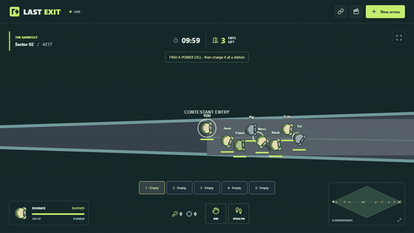

# Last Exit

**Last Exit** is an asymmetric top-down escape game prototype and browser-based multiplayer testbed. Eight contestants navigate a large, procedurally generated elongated diamond arena to charge and extract with power cells, while three gladiators hunt them using specialized tracking kits and a private transit network as a sweeping hazard forces the match forward. Empty player slots are filled by autonomous bots.

The project is in active development. It has moved well past an initial proof of concept into a structured, deterministic engineering foundation—with an authoritative 20 Hz simulation, a multi-stage macro-to-micro map generation pipeline, free-space polygon navigation with limited-knowledge bot planning, bounded replay recording, and an integrated suite of browser developer labs—while final cyberpunk art direction, live-chain trap authoring, multiplayer balance tuning, and experimental Rapier 2D physics promotion remain in progress.



*Recorded from a live match with `npm run demo` ([media/last-exit-demo.mp4](media/last-exit-demo.mp4)). Note: this earlier capture predates the live macro-to-micro generation chain and normal-slot power cells; it shows opening traversal and the objective rather than a fight, as the two roles spawn at opposite ends of the arena.*

---

## Current State at a Glance

| Area | Implemented and Active (`last-exit-0.7` / `content-5`) | Experimental or In Progress |
| --- | --- | --- |
| **Core Gameplay** | 8 contestants vs. 3 gladiators (Warden, Specter, Striker), 3 shared extraction slots, 5-second power-cell charging, 6-slot inventory with drag-and-drop and stack merging, doors and windows, west-to-east hazard wall. | Spatial weapon quality tiers (`content-loot-1`, #443) and magazine reloading with ammo reserves (`content-ammo-1`, #444) are implemented as opt-in content pending balance signoff ([14](docs/14-match-rules.md)). |
| **Map Generation** | Unified macro-to-micro generation chain ([50](docs/50-map-generation.md), [51](docs/51-generation-chain.md)): tile placement, layout regions, reachability proofs, region briefs, and bespoke micro builders (`depot`, `compound`, `block`, `hut`, `ruins`, etc.) at `12x6` (default), `24x12`, and `36x18` zone sizes. | Recursive execution of explored decomposition trees ([19](docs/19-decomposition-design.md)), second building-library milestone ([56](docs/56-buildings.md)), and live-chain trap/sensor/locked-door authoring ([16](docs/16-deferred.md)). |
| **Bot Navigation** | Eroded free-space polygon navmesh ([22.6.1](docs/22.6.1-portal-graph-and-mesh.md)), contestant discovery-grid knowledge filter with optimistic planning ([22.6.2](docs/22.6.2-knowledge-and-doors.md)), sliced multi-tick replanning, and immediate local route repair ([22.6.3](docs/22.6.3-bot-adoption.md)). | Dynamic body avoidance and drop occupancy (`content-physics-8`, [22.6.4](docs/22.6.4-dynamic-overlay.md)) for physical props and crowds. |
| **Physics & Contact** | Deterministic circle/polygon movement and sight sweeps via `shared/shape.ts` and SAT.js, shared between authoritative server ticks and client prediction. | Opt-in Rapier 2D adapter (P1–P9, [41.1](docs/41.1-physics-plan.md)): narrow character bodies, pushable crates, physical loot, swept hook ability, bounded client prediction, and isolated ballistics/jelly labs ([42.20](docs/42.20-physics-p9.md), [42.21](docs/42.21-jelly-squish.md)). |
| **Networking & Replays** | Authoritative 20 Hz server loop, per-viewer potential-visibility filtering, client-side sight polygons and roof cutaways, local prediction + interpolated receive buffer, lobbies/auto-matchmaking, and compressed SHA-256 verified replay archives. | Public internet hosting, account authentication, and persistent progression are intentionally out of scope for this local/LAN slice ([28](docs/28-operational-limits.md)). |

---

## Quick Start

Requires **Node.js 24.15.0 or newer** (verified with npm 12.0.2; exact dependency versions are locked in `package-lock.json`).

```powershell
npm ci
npm --prefix map/macro ci
npm run dev
```

Open the URL printed by the server, normally `http://127.0.0.1:3100` (or the next free port up to `3109`). A `PORT` set in the environment or in an untracked `.env.local` beside `package.json` is used exactly, and the server stops if that port is busy; `PORT=0` picks any free port. The server binds to loopback by default and must stay running while playing; `Ctrl+C` stops it and finalizes active recordings.

The shared simulation and map modules are written in TypeScript and run directly without a build step or `dist/` directory—Node strips types as it loads modules, and the dev server does the same on the fly for the browser. Type checking is a separate verification gate, not a step between editing a file and running it.

### Playing on a Local Network (LAN)

To let other devices on the same network join:

```powershell
npm run dev:lan
```

Open one of the printed LAN URLs (such as `http://192.168.1.25:3100`) from each client device. Windows may prompt to allow Node.js through the firewall on private networks. LAN mode is local-network only and does not configure public internet hosting.

---

## Gameplay and Controls

| Action | Keyboard and mouse | Touch |
| --- | --- | --- |
| Move | `WASD` or arrow keys | Left virtual stick |
| Aim | Mouse pointer | Right virtual stick |
| Fire / melee | Hold left mouse button | Deflect right stick |
| Select equipment slot | `1` to `6` | Slot buttons |
| Move / merge item | Drag between slots, or `M` then destination `1`–`6` | Drag between slots, or Move/merge then destination slot |
| Reload (`content-ammo-1` only) | `R` | Reload button |
| Drop reserve ammo (`content-ammo-1` only) | Click a reserve chip | Tap a reserve chip |
| Gladiator kit ability | `Q` | Ability button |
| Open/close door / charge cell / extract / transit | `E` | Hand button |
| Drop equipment | Drag a slot into the arena, or `G` for selected item | Drag a slot into the arena, or Drop selected button |
| Sneak | Hold `Shift` | Hold footprints button |
| Fullscreen | `F` | Fullscreen button |
| Toggle Dev View (`npm run dev`) | `` ` `` (backquote) or top-bar telescope button | Top-bar telescope button |
| Toggle Profiler Overlay | `P` (or `?profile=1`) | `?profile=1` |

### Match Rules

- **Objective:** Contestants must find an uncharged power cell, press `E` at one of the three charging stations and stay still for five seconds (100 ticks; progress is retained if interrupted), and carry the charged cell to the extraction site. Three shared extraction slots are available within a ten-minute match deadline.
- **Arena & Scale:** Default live matches generate a `12x6` diamond zone plan (17,280 × 8,640 world units) on a background worker thread (`map/live.ts`). Private rooms can also select larger `24x12` and `36x18` authored zone libraries. Each contestant start includes a nearby starter pistol and uncharged cell.
- **Equipment:** Walk over loot to collect it into six mixed equipment slots. Weapons (pistol, rifle, scattergun) carry finite ammunition; medkits and shields stack up to three; power cells take one slot each and never stack. Drag slots to rearrange, merge, or drop them into the arena. Contestants can damage one another and have no innate kit ability.
- **Gladiators:** Three hunters spawn at the departure end and fast-travel across six distributed blue transit stations with `E`. **Warden** triggers a close-range shockwave, **Specter** runs a radial scan, and **Striker** activates a speed burst. Claiming kills upgrades gladiator damage and ability recovery. Eliminated gladiators respawn after 20 seconds at a safe transit station ahead of the hazard wall with earned upgrades retained.
- **Sight & Information:** The live camera fills your viewport rather than clipping sight to a circle. Solid structures and closed doors block line of sight; building roofs conceal interiors from the outside and cut away when you step inside. Windows pass sight and gunfire but block movement and item reach. Static terrain stays visible in shadow when out of sight, while actors, loot, traps, and projectiles appear only in direct sight. Previously observed doors retain their last seen state (marked as remembered) until seen again. The minimap is schematic; for contestants it reveals only discovered areas, while gladiators see the full arena layout.
- **Lobbies & Matchmaking:** The Lobbies dialog lets you choose a role, kit, and callsign, browse and join open rooms, use **Auto** to matchmake into a shared 15-second countdown room, or configure and deploy a private room (with custom seed and zone size `12x6`, `24x12`, or `36x18`). Copying the arena link lets another tab or LAN device join and take over an available bot. Empty live rooms close and archive after a 30-second reconnect grace.

---

## Developer Portal and Tools

When running under `npm run dev` or `npm run dev:lan` (`--dev-tools=all`), the game server hosts an integrated **Developer Portal** at `/dev` (`http://127.0.0.1:3100/dev`) with a shared navigation bar across all interactive inspection labs:

- **Map Lab (`/dev/map`):** Whole-map generator and generation-chain inspector ([53.1](docs/53.1-map-lab-and-tools.md)). Preview every stage of the chain (`Layout`, resolved classes, regions, portals, reachability proof components, zone tiers, loot heatmaps, building drill-downs, and contestant vs. hunter route comparisons), edit and validate tile and set-piece libraries in the **Chain Library** tab, preview parameterized assemblies in the **Placeables** tab, or launch the exact seed directly into a live game room.
- **Region Builder Explorer (`/dev/micro`):** Interactive workbench for testing individual micro region strategies (`depot`, `compound`, `block`, `hut`, `park`, `plant`, `ruins`, etc.) across customizable shapes and sizes ([20.5](docs/20.5-tools-and-next-boundaries.md)). Inspect building design graphs, space allocations, roofs, and portal clearance routes, and walk the generated collision geometry as either role using `WASD` and `E`.
- **Decomposition Inspector (`/dev/micro/decomposition`):** Visualizes polyomino region partitioning, neck cuts, candidate footprints, residual scoring, and bounded recursive allocation trees ([19](docs/19-decomposition-design.md), [20.4](docs/20.4-hierarchical-generation.md)).
- **Generation Trace (`/dev/micro/generation`):** Step-by-step walkthrough of a decomposing `block` region through *Region → Decomposition → Generated → Walk* stages.
- **Physics Playtest (`/dev/physics`):** Local browser simulation workbench for the experimental Rapier 2D integration ([42.20](docs/42.20-physics-p9.md)). Test character contact and doorway crowd squeezes (Scene A), pushable rotated crates and physical loot (Scene B), and the gladiator hook tether (Scene C), complete with solver contact/force overlays, swept disk casts, and deterministic JSON action-trace export/rerun.
- **Standalone Physics Labs:** Run `npm run physics:ballistics` or `npm run physics:jelly` to generate self-contained HTML viewers under `test-results/` for the 2½D thrown-cube ballistics lab ([42.18](docs/42.18-physics-p7.md)) and native-spring jelly/player-squish prototype ([42.21](docs/42.21-jelly-squish.md)).
- **In-Match Dev View:** Press `` ` `` (backquote) or click the telescope button in a live match (or open `?room=<id>&dev`) to step out of your character into an undelayed, unfogged whole-arena overview. Pan with drag/`WASD`, zoom with the wheel, click any player or bot to follow them in their own sight (`V` toggles their fog, `Esc` stops following, `0` resets to the arena), press `T` to teleport the followed actor to the cursor, or press `Space` to pause the room. Controlled on the server by `DEV_TOOLS=none|owner|all` (`--dev-tools=`).
- **Non-Player Spectators:** Joining a room as a spectator with the room owner key provides an unfogged directed view delayed by 60 simulation ticks (3 seconds) without enabling dev-tool manipulation ([24](docs/24-networking-privacy.md)).

Command-line and MCP tools for map generation and region inspection (`map/tools/cli.mts`, `map/tools/mcp.mts`, `tools/micro-region.mjs`, `tools/decompose-region.mjs`, `tools/builder-fill.mjs`) are documented in [53.1](docs/53.1-map-lab-and-tools.md) and [20.5](docs/20.5-tools-and-next-boundaries.md).

---

## Repository Layout

```text
├── shared/          # Portable TypeScript core shared by server and browser (simulation, geometry,
│                    #   free-space navmesh, bot planning, equipment, visibility, frame layers, physics)
├── map/             # Procedural map generation (never imported by shared/; enforced by boundary tests)
│   ├── kernel/      # Zero-dependency shared map space: macro/micro contract, body scale, cells, runs
│   ├── macro/       # Macro generator ("mapgen"): WFC tile placement, layout regions, proofs, libraries
│   ├── micro/       # Micro generation SDK, building library, and per-region builders/decomposers
│   ├── tools/       # Shared Map Lab (/dev/map), CLI (cli.mts), MCP server (mcp.mts), and seed sweep
│   └── live.ts      # Runtime adapter turning built chain maps into playable arena maps
├── server/          # Authoritative 20 Hz Node/Express/WebSocket server, room lifecycle, replay writer
├── public/          # Browser client (Phaser renderer, snapshot buffer, UI, replay player, /dev portal)
├── docs/            # Numbered product, engineering, process, performance, and mapgen documentation
├── tests/           # Fast and slow unit suites, Playwright browser tests, benchmarks, frozen fixtures
└── tools/           # CLI utilities, physics/navigation report harnesses, and historical audit scripts
```

Architectural ownership and module boundaries are enforced by automated tests and recorded in [22](docs/22-ownership.md) and [50](docs/50-map-generation.md).

---

## Replays, Profiling, and Diagnostics

### Replays
The server records simulation ticks to compressed JSON archives under `replays/` ([26](docs/26-recording-contract.md)). Open completed matches from the clapperboard button in the top bar; the room creator can also end a match early to save immediately. Playback supports pause, timeline seeking, speed selection, camera follow, and raw JSON download.

Recordings capture exact authoritative simulation states—actors, positions, health, cooldowns, bot routes, objects, projectiles, accepted commands, seed, map geometry, pinned content ID, and simulation version—verified by SHA-256 stream metadata. Bounded recording (8 MiB pending budget per room) never stalls live gameplay: if storage falls behind, frames are omitted and marked cleanly as gaps during playback.

### Performance Diagnostics & Profiling
If a live match stutters, open **Replays → Download performance diagnostics** to save a sanitized JSON report of recent frame times, packet gaps, viewport metrics, and room counts (see [42](docs/42-performance-history.md)).

Low-overhead profiling hooks are compiled into the simulation, server loop, and renderer, and remain off by default:

```powershell
npm run bench
npm run bench:client
```

To pass benchmark flags directly (avoiding npm 12 flag interception in PowerShell):

```powershell
node tests/bench.mjs --rooms=2 --ticks=300 --clients=8
node tests/bench-client.mjs --location=dense --seconds=30
```

- `bench` runs the simulation headless and reports per-tick CPU cost against the 50 ms (`20 Hz`) budget, phase/counter breakdowns, and concurrent room capacity.
- `bench:client` drives a live match in headless Chrome and reports renderer phases, frame times, and server state arrival gaps.
- Start a server with `PROFILE=1` (or toggle via `POST /api/profile` and read `GET /api/profile`) for live server telemetry. In the browser, press `P` or append `?profile=1` for the live profiler overlay, or call `window.arenaProfile()` in the console.

---

## Verification

```powershell
npm run check         # Parses all JS modules and verifies clean TypeScript type erasure
npm run typecheck     # Strict tsc --noEmit across shared/, map/micro/, map/kernel/, and map/tools/
npm test              # Fast unit and integration suite (concurrency-capped for rapid iteration)
npm run test:all      # Full unit suite including slow seed sweeps and whole-match bot runs
npm run test:mapgen   # Typecheck and unit/quota suite for the macro generator in map/macro/
npm run test:micro    # Micro-generation unit tests plus browser checks for /dev/micro labs
npm run test:physics  # Focused Rapier 2D physics, item identity, hook, and dynamic navigation suite
npm run test:browser  # End-to-end Playwright suite in Google Chrome (game, dev view, labs, physics)
npm run test:times    # Measures per-file execution times against the 15s (fast) / 60s (slow) budgets
```

Forgejo CI runs `check`, `typecheck`, `npm test` and `test:mapgen` on every pull request and on `main`; the slow, browser and benchmark tiers stay manual ([31](docs/31-verification.md#continuous-integration)). Forgejo is the source of truth; GitHub is the public copy, where `main` is published by hand and branches started there come back to Forgejo for review ([34](docs/34-forgejo-workflow.md#github)).

Full verification gates, coverage details, and the frozen characterization baseline policy (`tests/fixtures/behavior-nav-1.json.gz`, which guards against unintended simulation regressions across refactors) are documented in [31](docs/31-verification.md) and [tests/fixtures/README.md](tests/fixtures/README.md).

---

## Documentation

Project requirements, architecture contracts, verification policies, and measured engineering history live in [docs/](docs/), organized into numbered families so contributors and agents can load only the context relevant to a task. Start at [**docs/00-index.md**](docs/00-index.md):

- **`1x` — Product:** [11 Product intent](docs/11-product-intent.md), [12 Player requirements](docs/12-player-requirements.md), [13 Accepted features & status](docs/13-accepted-features.md), [14 Match rules & defaults](docs/14-match-rules.md), [15 Information & sight rules](docs/15-information-rules.md), [16 Deferred work](docs/16-deferred.md), [17 Open questions & answers](docs/17-open-questions.md).
- **`2x` — Engineering:** [20 Micro generation](docs/20-micro-generation.md), [21 Stack decisions](docs/21-stack.md), [22 Subsystem ownership](docs/22-ownership.md) (including [22.6 Hierarchical navigation](docs/22.6-hierarchical-navigation.md)), [23 TypeScript arrangement](docs/23-types.md), [24 Networking & privacy](docs/24-networking-privacy.md), [25 Pacing & rendering](docs/25-pacing-and-rendering.md), [26 Recording contract](docs/26-recording-contract.md), [28 Operational limits](docs/28-operational-limits.md), [29 Geometry, drawing & physics](docs/29-geometry-and-drawing.md).
- **`3x` — Process:** [31 Verification](docs/31-verification.md), [32 Delegation](docs/32-delegation.md), [33 Documentation maintenance](docs/33-maintenance.md), [34 Forgejo workflow](docs/34-forgejo-workflow.md).
- **`4x` — Plan & History:** [41 Roadmap](docs/41-roadmap.md), [41.1 Physics plan](docs/41.1-physics-plan.md), [42 Performance history & measured baselines](docs/42-performance-history.md).
- **`5x` — Map Generation:** [50 Overview & ownership](docs/50-map-generation.md), [51 Generation chain](docs/51-generation-chain.md), [52 Primitives & library](docs/52-map-primitives-and-library.md), [53 Artifacts & tools](docs/53-map-artifacts-and-tools.md), [54 Region type catalogue](docs/54-region-types.md), [55 Zone plans](docs/55-zone-plans.md), [56 Buildings](docs/56-buildings.md).

---

## License

The project's original code and original assets are licensed under the [MIT License](LICENSE). Third-party dependencies, libraries, and assets incorporated or redistributed retain their own respective licenses and notices.
