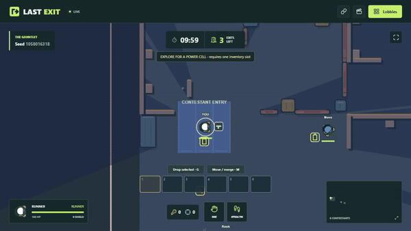
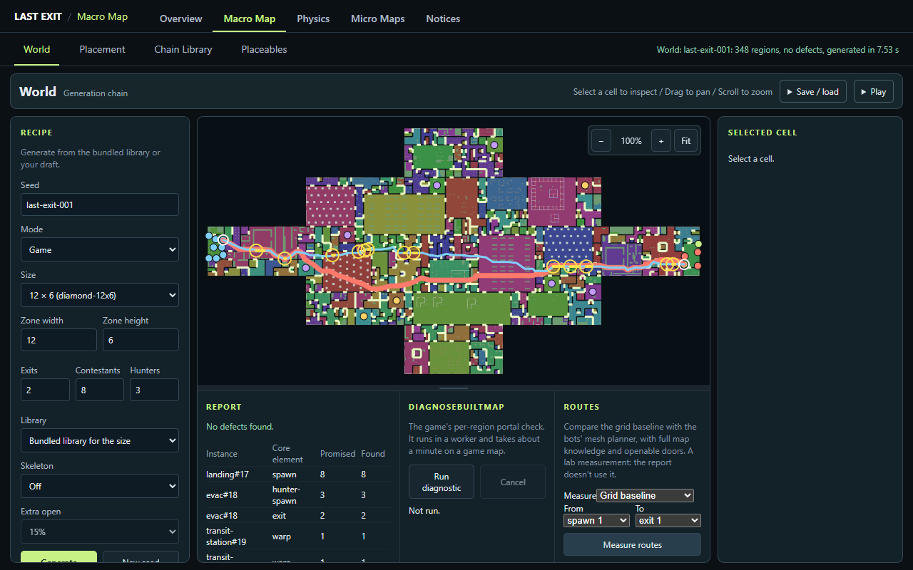

# Last Exit

**Last Exit** is an asymmetric top-down multiplayer escape game prototype and browser-based testbed. Eight contestants navigate a procedurally generated diamond arena to charge and extract with power cells across three shared escape slots, while three gladiators hunt them using tracking and mobility kits and a fast-travel transit network as a sweeping hazard wall forces the match eastward. Autonomous bots fill unclaimed slots.

Built for local and LAN play alongside a suite of browser developer labs, the prototype runs on an authoritative 20 Hz server simulation with required Rapier 2D physics, a macro-to-micro map generation chain, eroded free-space polygon navigation with limited-knowledge bot planning, and bounded replay recording.



*Live match capture ([media/last-exit-demo.mp4](media/last-exit-demo.mp4), recorded with `npm run demo`).*



*The integrated Map Lab (`/dev/map`), showing a generated `12 × 6` arena, core element report, and measured contestant vs. hunter routes.*

---

## Quick Start (Host and Client)

Requires **Node.js 24.15.0 or newer** (verified with npm 12.0.2).

```powershell
npm ci
npm --prefix map/macro ci
npm run dev
```

Open the URL printed by the server—normally `http://127.0.0.1:3100` (or the next free port up to `3109`). Setting `PORT` in the environment or in an untracked `.env.local` beside `package.json` binds that exact port and stops if it is busy (`PORT=0` picks any free port). Keep the server running while playing; `Ctrl+C` stops it and finalizes active recordings.

Opening the base URL creates a private lobby. Choose your role and kit, share the arena link with other players, then click **Start match**; unclaimed slots become bots. For shared matchmaking, use **Lobbies → Auto** instead.

### Playing on a Local Network (LAN)

To host a match that other devices on your local network can join:

```powershell
npm run dev:lan
```

If Windows asks, allow Node.js through the firewall on private networks. The host opens one of the printed LAN URLs (for example `http://192.168.1.25:3100`), then copies the arena link from the lobby or top bar. Each client opens that shared room link in a desktop or mobile browser to join the same match; late joiners take over available bots. LAN mode is for local networks only and does not configure public internet hosting ([28](docs/28-operational-limits.md)).

---

## How a Match Works

- **Objective:** Contestants find an uncharged power cell, press `E` at one of three charging stations and stay still for five seconds (100 ticks; progress is kept if interrupted), then carry the charged cell to the eastern extraction site and press `E` to escape before the ten-minute deadline or the advancing hazard wall overtakes them. Three shared extraction slots are available.
- **Equipment:** Contestants carry six mixed inventory slots (`1`–`6`, drag-and-drop to rearrange, merge stacks, or drop into the arena). Weapons carry finite ammunition; medkits and shields stack up to three; power cells take one slot each and never stack. Contestants can damage one another and have no innate kit ability.
- **Gladiators:** Three hunters spawn at the departure end and fast-travel between six transit stations with `E`. Choose **Warden** (close-range shockwave), **Specter** (radial scan), **Striker** (speed burst), or **Hook** (swept tether pull) in the lobby; press `Q` to use the kit ability. Eliminated gladiators redeploy after 20 seconds at a safe transit station ahead of the hazard wall with earned kill upgrades retained.
- **Sight and Information:** Solid walls and closed doors block sight; building roofs conceal interiors from outside and cut away when you step inside. Windows pass sight and gunfire but block movement and item reach. Static terrain stays visible in shadow outside direct sight, remembered doors keep their last observed state, and contestants' schematic minimaps reveal only discovered areas.
- **Lobbies and Rooms:** Use **Lobbies** to pick a role, kit, and callsign, matchmake via **Auto** (15-second countdown at the default `12x6` zone size), or deploy a private room with a custom seed and zone size (`12x6`, `24x12`, or `36x18`).

Full keyboard, mouse, touch, spectating, replay, and diagnostic controls are in [**README.controls.md**](README.controls.md). Authoritative match rules and selectable content sets live in [**docs/14-match-rules.md**](docs/14-match-rules.md).

---

## Development at a Glance

Shared simulation and map-generation modules are written in TypeScript and run directly without a build step—Node strips types on import, and the dev server does the same on the fly for the browser.

- **`shared/`** — Portable simulation core (fixed-tick rules, Rapier 2D physics adapter, geometry, free-space navmesh, bot planning, equipment, visibility, wire and recording formats). Never imports `map/`.
- **`map/`** — Procedural map generation: `map/kernel/` (zero-dependency shared contract and scale), `map/macro/` (WFC tile placement, layout regions, reachability proofs, region briefs), `map/micro/` (region builders, building library, decomposition SDK), `map/tools/` (Map Lab, CLI, MCP server, seed sweep), and `map/live.ts`.
- **`server/` & `public/`** — Authoritative 20 Hz Express/WebSocket server, room lifecycle, bounded replay writer, and Phaser browser client.
- **`docs/`, `tests/`, `tools/`** — Numbered documentation ([**docs/00-index.md**](docs/00-index.md)), fast/slow unit and browser suites, and CLI/diagnostic utilities.

When started with `npm run dev`, the server hosts the **Developer Portal** at `/dev` (`/dev/map`, `/dev/micro`, `/dev/micro/decomposition`, `/dev/micro/generation`, `/dev/physics`). Core verification gates are `npm run check`, `npm run typecheck`, `npm test`, and `npm run test:mapgen`; see [31](docs/31-verification.md) for area-specific checks, [22](docs/22-ownership.md) for subsystem ownership, and [50](docs/50-map-generation.md) for map generation.

---

## Contributing and Direction

**Contributions:** External pull requests and contributions are not currently accepted. The public GitHub repository is a read-only mirror of the development repository on Forgejo ([34](docs/34-forgejo-workflow.md#github)).

**Current state and roadmap:** Core match rules, Rapier 2D physics, the macro-to-micro generation chain, free-space bot navigation, delta-frame replay recording, and developer labs are active. Upcoming efforts—world and art direction, unified development-tool faces, map obstruction, spatial reward and danger curves, equipment/physics qualification, netcode, and renderer batching—are tracked in [**docs/41-roadmap.md**](docs/41-roadmap.md), [**docs/13-accepted-features.md**](docs/13-accepted-features.md), and [**docs/16-deferred.md**](docs/16-deferred.md).

---

## More Paths

- **Controls, replays, spectating, and diagnostics:** [README.controls.md](README.controls.md)
- **Content authors (labs, tile libraries, region builders, CLI & MCP tools):** [README.authoring.md](README.authoring.md) and [map/macro/README.md](map/macro/README.md)
- **Forking and extending the project (full repository tree, verification commands, licensing):** [README.forking.md](README.forking.md)
- **Maintainers' and agents' workflow:** [docs/34-forgejo-workflow.md](docs/34-forgejo-workflow.md) and [AGENTS.md](AGENTS.md)
- **Full documentation index:** [docs/00-index.md](docs/00-index.md)

---

## License

Original code and assets are licensed under the [MIT License](LICENSE). Redistributed third-party libraries retain their own licenses and notices in [THIRD-PARTY-NOTICES.txt](THIRD-PARTY-NOTICES.txt) (served at `/third-party-notices.txt`); see [docs/21.1-third-party-licenses.md](docs/21.1-third-party-licenses.md).
